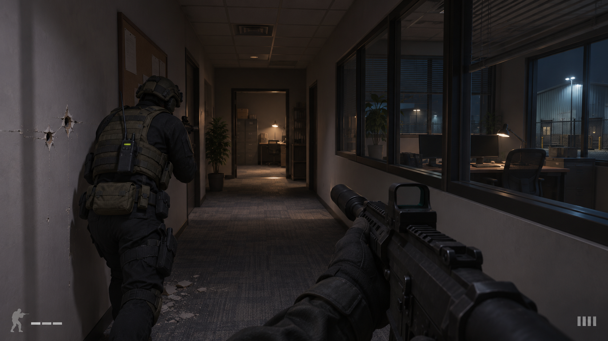
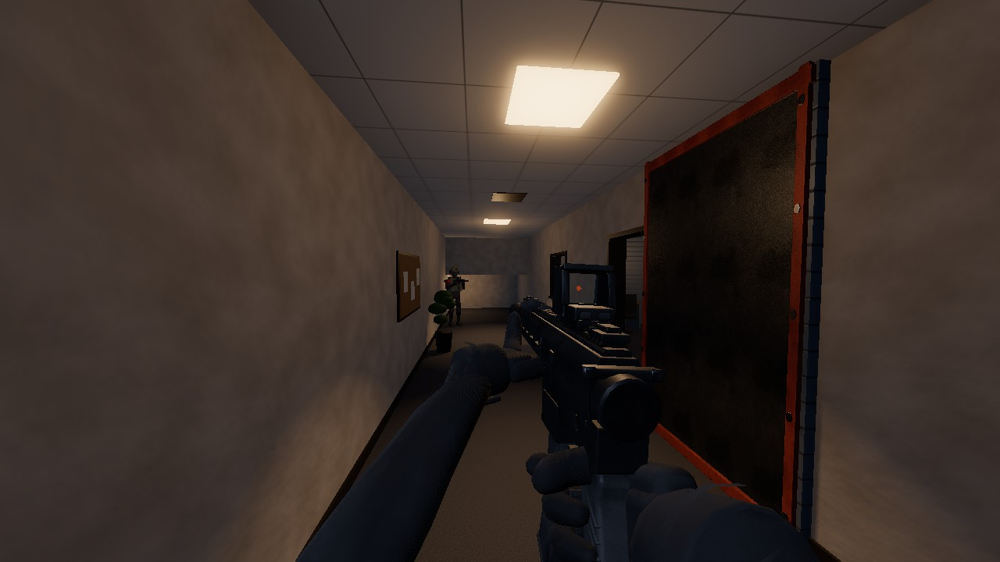
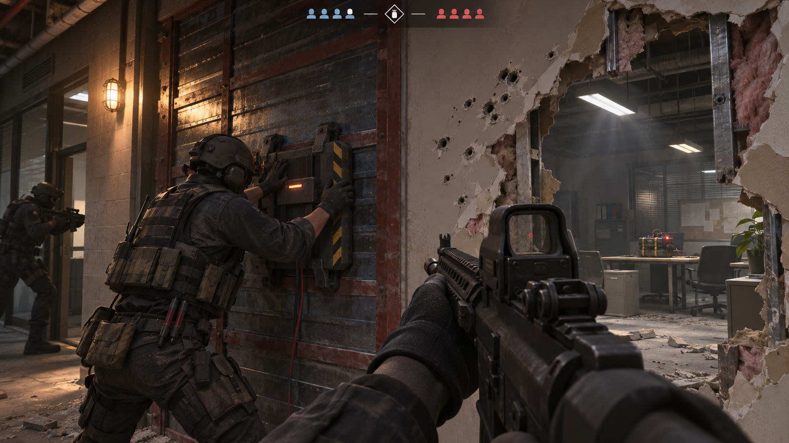
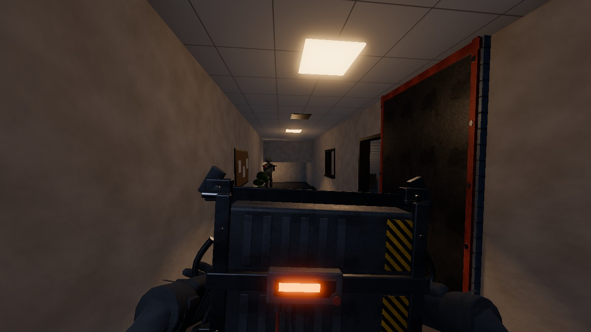
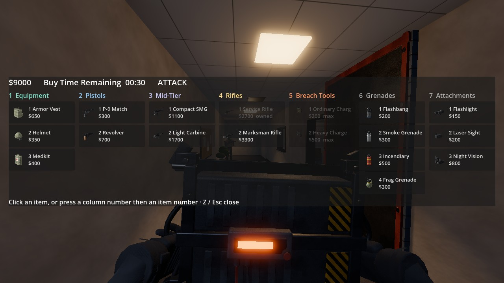

# Session 09.75 visual review

The committed seven guns were preserved. The resumed work added the pending gear, rigged arms, wearable models, world gear, icons and gameplay. These screenshots are a prototype review, not a claim that the illustrated reference quality has been reached.

| Target | Current game |
| --- | --- |
|  |  |
|  |  |

The palette, rail/sight silhouette, hazard markings and red reinforcement frames follow the reference direction. The remaining visual gap is substantial: glove fingers and grip contact remain simplified, operator clothing lacks the reference's folds and proportion detail, and smoke/fire are simple gameplay volumes. The arm rig removes the curved-hose forearms and allows elbow anchoring during the existing socket-driven reloads. It is ready for later hand/arm mesh replacement; no third-party animation clips were imported.

The shop uses model-rendered icons and two-line price labels. Full item names remain available in tooltips. Final visual acceptance, throw feel, ADS comfort and Windows performance require user playtesting.
